# SI UKM UB — Sistem Informasi Pendaftaran Unit Kegiatan Mahasiswa Universitas Brawijaya

Aplikasi web terintegrasi untuk pendaftaran, seleksi berkas, dan pengumuman hasil seleksi Unit Kegiatan Mahasiswa (UKM) di lingkungan Universitas Brawijaya.

Sistem ini dibangun dengan arsitektur **MVC (Model-View-Controller) / BCE (Boundary-Control-Entity)** modern berbasis **JavaScript ES Modules + Vite** di sisi klien (*Client-Side Controller & View*), dan **Supabase (PostgreSQL Relational DB, Row Level Security, Auth OTP, & Cloud Storage)** di sisi backend.

---

## 🏛️ Arsitektur Sistem (MVC & BCE)

Aplikasi ini membagi tanggung jawab sistem secara ketat (*Separation of Concerns* & *Single Responsibility Principle*):

```mermaid
flowchart LR
    subgraph VIEW ["1. VIEW (Boundary)"]
        V1["src/pages/<br/>(Katalog, Detail, Form 3-Tahap, Riwayat, Hasil)"]
        V2["src/components/<br/>(UKMCard, Stepper, Dialog, Input Form)"]
    end

    subgraph CONTROLLER ["2. CONTROLLER (Control)"]
        C1["src/router.js<br/>(Client-Side Route Controller & Guards)"]
        C2["src/services/<br/>(Orkestrasi Logika Bisnis & Panggilan API)"]
        C3["src/utils/<br/>(Validator Berkas, Regex Email, Kriptografi)"]
    end

    subgraph MODEL ["3. MODEL (Entity & Backend)"]
        M1["src/models/<br/>(Mahasiswa, UKM, Pendaftaran, Dokumen)"]
        M2["src/enums/<br/>(Status Pendaftaran, Berkas, Seleksi)"]
        M3["Supabase Backend<br/>(PostgreSQL DB, Storage Bucket, Auth)"]
    end

    VIEW <-->|Interaksi Pengguna & Event| CONTROLLER
    CONTROLLER <-->|Query Data & Mutasi State| MODEL
```



> 📘 **Dokumentasi Lengkap:** Penjelasan mendalam mengenai pemetaan MVC, fungsi tiap folder, fungsi berkas, dan bagian kode penting dapat dibaca di berkas [`docs/Panduan_Arsitektur_Kode_SI_UKM.md`](docs/Panduan_Arsitektur_Kode_SI_UKM.md).

---

## 🚀 Fitur Utama

### Sisi Mahasiswa (Frontend & Client-Side Logic):
1. **Autentikasi & Keamanan:**
   - Registrasi mahasiswa dengan validasi domain resmi `@student.ub.ac.id`.
   - Verifikasi token 6-digit OTP email asli.
   - Penyimpanan password hash menggunakan algoritma **SHA-512 + Salt email** (Web Crypto API).
   - Persistensi sesi login lokal terenkripsi di `localStorage`.
2. **Katalog & Detail UKM (M-01 & M-02):**
   - Pencarian real-time, filter kategori, dan filter status pendaftaran.
   - Hitung mundur (*live countdown*) batas waktu penutupan pendaftaran.
   - **Pencegahan Pendaftaran Ganda:** Tombol pendaftaran otomatis dinonaktifkan (abu-abu "Sudah Terdaftar") jika mahasiswa telah mendaftar di UKM tersebut.
3. **Formulir Pendaftaran Wizard 3-Tahap (M-03, M-04, M-05):**
   - **Tahap 1 (Data Diri):** Auto-fill identitas terkunci dari profil sesi login.
   - **Tahap 2 (Unggah Berkas):** Validasi format (PDF/JPG) & batasan ukuran berkas (< 5MB) untuk KTM, Transkrip, dan CV.
   - **Tahap 3 (Review & Konfirmasi):** Ringkasan berkas, persetujuan fakta integritas, dan pengiriman aman.
4. **Riwayat & Pelacakan Status Berkas (M-08):**
   - Stepper 5-tahap pelacakan proses pendaftaran (*Terdaftar $\rightarrow$ Verifikasi Berkas $\rightarrow$ Seleksi $\rightarrow$ Pengumuman $\rightarrow$ Selesai*).
   - Umpan balik catatan perbaikan berkas langsung dari Admin UKM.
5. **Pengumuman Hasil Seleksi & Langkah Selanjutnya (M-09):**
   - Badge status resmi (*DITERIMA*, *DITOLAK*, *PENDING*).
   - Panduan langkah selanjutnya bagi yang diterima (tautan grup WhatsApp resmi UKM & kontak koordinator).
6. **Pusat Notifikasi Real-Time:**
   - Lonceng notifikasi di navbar dengan indikator badge merah counter pesan belum dibaca.

### Sisi Backend (Supabase PostgreSQL & Cloud Storage):
- **Database Relasional:** 8 entitas tabel normalisasi (`pengguna`, `mahasiswa`, `admin_ukm`, `ukm`, `kategori`, `pendaftaran`, `dokumen_pendaftaran`, `notifikasi`).
- **Data Integrity & Anti-Duplicate:** `UNIQUE INDEX (id_ukm, id_mahasiswa)` di tabel `pendaftaran`.
- **Cloud Storage Bucket:** Bucket privat/publik `dokumen` untuk penyimpanan fisik file PDF/JPG berkas persyaratan.
- **Row Level Security (RLS):** Kebijakan pembatasan hak akses baca dan tulis data.

---

## 📁 Struktur Direktori

```
app/
├── docs/                     # Dokumentasi arsitektur sistem & panduan pengujian
│   └── Panduan_Arsitektur_Kode_SI_UKM.md
├── public/                   # Aset statis publik (logo UB, SVG icon sprite)
├── src/                      # Source code utama aplikasi (MVC)
│   ├── components/           # [VIEW] Komponen UI modular (UKMCard, Stepper, Dialog, Form)
│   ├── enums/                # [MODEL] Konstanta nilai sah status data (Single Source of Truth)
│   ├── layouts/              # [VIEW] Frame tata letak global (AppShell & Navbar)
│   ├── models/               # [MODEL] Representasi entitas domain OOP
│   ├── pages/                # [VIEW] Halaman per use case (auth/ dan mahasiswa/)
│   ├── services/             # [CONTROLLER] Layer logika bisnis & API client Supabase
│   ├── state/                # [MODEL] Client-side state & session management
│   ├── styles/               # [VIEW] Styling CSS modular responsif
│   ├── utils/                # [CONTROLLER] Fungsi utilitas, validator berkas, crypto
│   ├── config.js             # Konfigurasi aplikasi & URL API
│   ├── main.js               # Entry point eksekusi JavaScript
│   └── router.js             # [CONTROLLER] Client-side router SPA berbasis hash
├── supabase/                 # [BACKEND] Skrip SQL PostgreSQL & RLS Policy
│   ├── schema.sql            # Definisi tabel, relasi foreign key, dan index
│   ├── seed.sql              # Data awal demonstrasi sistem
│   ├── rls-tulis.sql         # Kebijakan Row Level Security & Storage bucket
│   └── pengumuman-dummy.sql  # Skrip injeksi hasil seleksi & notifikasi simulasi
├── tests/                    # Pengujian otomatis unit test (Vitest)
├── testing/                  # Dokumentasi skenario pengujian whitebox
├── index.html                # Dokumen induk HTML SPA
├── package.json              # Manifest project Node.js & dependencies
├── vercel.json               # Konfigurasi deployment hosting Vercel
└── vite.config.js            # Konfigurasi bundler Vite & runner Vitest
```

---

## 🛠️ Prasyarat & Instalasi Lokal

### Prasyarat
- **Node.js** v18.0.0 atau lebih baru
- Akun dan Project **Supabase**

### 1. Konfigurasi Backend Database (Supabase)
Buka menu **SQL Editor** pada Supabase Dashboard Anda, lalu jalankan berkas SQL berikut secara berurutan:
1. `supabase/schema.sql` (Inisialisasi tabel, relasi, tipe enum, dan indeks)
2. `supabase/seed.sql` (Mengisi data master UKM, kategori, dan akun demo)
3. `supabase/rls-tulis.sql` (Mengaktifkan hak akses tulis pendaftaran dan bucket storage berkas)

### 2. Konfigurasi Environment Variable
Salin berkas `.env.example` menjadi `.env`, lalu isi kredensial project Supabase Anda:
```env
VITE_SUPABASE_URL=https://proyek-anda.supabase.co
VITE_SUPABASE_ANON_KEY=sb_publishable_kunci_anon_anda
```

### 3. Menjalankan Aplikasi
```bash
# Instalasi dependensi
npm install

# Jalankan development server lokal
npm run dev
```
Akses web melalui browser di `http://localhost:5173`.

---

## 🧪 Pengujian Otomatis (Testing)

Proyek ini dilengkapi dengan rangkaian pengujian unit otomatis menggunakan **Vitest**:

```bash
# Menjalankan seluruh pengujian unit
npm test

# Menjalankan pengujian dengan laporan cakupan kode (Code Coverage)
npm run test:coverage
```
*Status saat ini: **149 Automated Tests PASS 100%**.*

---

## 🚢 Deployment

Aplikasi ini telah dikonfigurasi untuk deployment instan di platform **Vercel** melalui berkas [`vercel.json`](vercel.json) dengan dukungan otomatis URL rewrite untuk Single Page Application (SPA).
