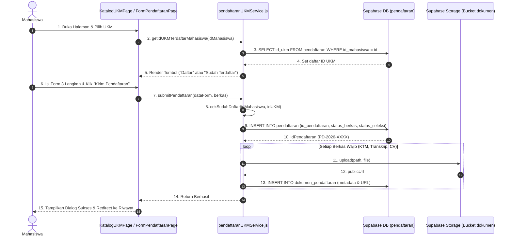

# Bedah Detail: Pemetaan Diagram EA vs Implementasi Kode Riil
**Proyek: Sistem Informasi Pendaftaran UKM Universitas Brawijaya (SI UKM UB)**

Dokumen ini membedah secara teknis baris demi baris, fungsi demi fungsi, dan method demi method hubungan antara **Enterprise Architect (EA)** dengan **Kode Program JavaScript & Database Supabase**.

---

## 1. Bedah Sequence Diagram: Alur Pendaftaran UKM Online (3-Tahap)
*File EA: `Daftar UKM Secara Online.qea`*

Di Sequence Diagram terdapat 5 Lifeline utama. Berikut pemetaan persis fungsi dan baris kodenya:

### Rincian Fungsi yang Terlibat:
1. **`getIdUKMTerdaftarMahasiswa(idMahasiswa)`** di `src/services/pendaftaranUKMService.js`:
   * Mengambil daftar UKM yang sudah didaftari mahasiswa untuk menonaktifkan tombol pendaftaran di katalog (`aria-disabled="true"`).
2. **`bolehAksesForm(ukm, sudahTerdaftar)`** di `src/utils/permissions.js`:
   * Guard logika bisnis yang mengunci form pendaftaran jika mahasiswa sudah pernah terdaftar atau jika masa pendaftaran sudah ditutup.
3. **`submitPendaftaran(dataForm, berkas)`** di `src/services/pendaftaranUKMService.js`:
   * Mengorkestrasi penyimpanan atomik data pendaftaran dan unggah fisik dokumen ke storage.

---

## 2. Bedah Sequence Diagram: Registrasi Akun Mahasiswa Baru & OTP
*File EA: `Registrasi Akun Mahasiswa Baru & Verifikasi Akun OTP.qea`*

| No Urut di EA | Pesan / Langkah di Diagram | Fungsi di Kode Kita | Lokasi File |
| :---: | :--- | :--- | :--- |
| **Step 1–3** | Input Nama, NIM, Email, Telp, Fakultas, Prodi, Password | Form HTML `buatTextField` | `src/pages/auth/DaftarMahasiswaPage.js` |
| **Step 4** | Validasi Domain Email & Password | `validasiEmailMahasiswa(email)` | `src/utils/validatorAuth.js` |
| **Step 5–11** | `kirimOtpPendaftaran(email, password)` | `kirimOtpRegistrasi(email)` memanggil `supabase.auth.signInWithOtp()` | `src/services/registrasiService.js` |
| **Step 12** | Simpan State Sementara & Navigasi | `simpanDataRegistrasiSementara(data)` | `src/state/registrasiTemp.js` |
| **Step 13–14** | Input 6-Digit Token OTP | Render form OTP | `src/pages/auth/VerifikasiOtpPage.js` |
| **Step 15–17** | `verifyOtp(email, token)` | `supabase.auth.verifyOtp()` memvalidasi token dari email student UB | `src/services/registrasiService.js` |
| **Step 18** | `hashPassword(password, email)` | `hashPasswordSHA512(password, email)` (Web Crypto API) | `src/utils/crypto.js` |
| **Step 19–20** | `INSERT INTO pengguna` | `supabase.from('pengguna').insert(...)` | `src/services/registrasiService.js` |
| **Step 21–22** | Pendaftaran Berhasil & Redirect | `navigasi('/auth/login-mahasiswa')` | `src/router.js` |

---

## 3. Bedah Sequence Diagram: Masuk Ke Sistem (Login Mahasiswa)
*File EA: `Masuk Ke Sistem.qea`*

| No Urut di EA | Pesan / Langkah di Diagram | Fungsi di Kode Kita | Lokasi File |
| :---: | :--- | :--- | :--- |
| **Step 1–4** | Input email & password, klik Masuk, validasi field | `validasiEmailMahasiswa()` & `validasiWajib()` | `src/pages/auth/LoginMahasiswaPage.js` |
| **Step 5–7** | `login(email, password)` & query pengguna | `supabase.from('pengguna').select('*').ilike('email', email)` | `src/services/loginService.js` |
| **Step 8–9** | Akun tidak ditemukan (alt branch) | Return error `"Akun belum terdaftar"` | `src/services/loginService.js` |
| **Step 10–11**| `verifikasiPassword(input, hash, email)` | Memverifikasi password hash SHA-512 + Salt email | `src/utils/crypto.js` |
| **Step 12–13**| `setSesi(user)` | Menyimpan sesi pengguna aktif ke `localStorage` key `si_ukm_sesi` | `src/state/session.js` |
| **Step 14–15**| Navigasi ke Halaman Katalog | `navigasi('/mahasiswa/katalog')` | `src/router.js` |

---

## 4. Bedah Class Diagram: Method & Atribut per Entitas
*File EA: `Class Diagram 2.qea`*

Berikut pembuktian bahwa Class di EA bukan sekadar gambar, melainkan memiliki implementasi nyata di kode:

### A. Class `UKM`
* **File Kode:** [`src/models/UKM.js`](file:///d:/Tugas%20Kuliah/Semester%203/Praktikum%20RSI/SI%20UKM%20UB/app/src/models/UKM.js)
* **Tabel Database:** `ukm`
* **Atribut:** `idUKM`, `namaUKM`, `idKategori`, `visiMisi`, `deskripsi`, `statusPendaftaran`, `statusVerifikasi`, `tanggalBuka`, `tanggalTutup`, `langkahSelanjutnya`, `foto`
* **Method yang Diterapkan di Kode:**
  * `findByStatus(daftarUKM, status)` $\rightarrow$ Filter UKM berdasarkan status dibuka/ditutup.
  * `findById(daftarUKM, idUKM)` $\rightarrow$ Pencarian UKM spesifik.
  * `updateStatus(daftarUKM, idUKM, status)` $\rightarrow$ Perubahan status pendaftaran.
  * `countByKategori(daftarUKM, idKategori)` $\rightarrow$ Agregasi jumlah UKM per kategori.

### B. Class `Pendaftaran`
* **File Kode:** [`src/models/Pendaftaran.js`](file:///d:/Tugas%20Kuliah/Semester%203/Praktikum%20RSI/SI%20UKM%20UB/app/src/models/Pendaftaran.js)
* **Tabel Database:** `pendaftaran`
* **Atribut:** `idPendaftaran`, `nomorPendaftaran`, `idUKM`, `idMahasiswa`, `tanggalDaftar`, `statusBerkas`, `statusSeleksi`, `catatanAdmin`, `catatanSeleksi`, `terkunci`
* **Method yang Diterapkan di Kode:**
  * `kunciPendaftaran()` $\rightarrow$ Mengunci berkas agar tidak dapat diubah setelah disubmit.
  * `updateStatusBerkas(status, catatan)` $\rightarrow$ Digunakan oleh admin untuk verifikasi berkas.
  * `updateStatusSeleksi(status, catatan)` $\rightarrow$ Digunakan oleh admin untuk kelulusan seleksi.

### C. Class `Pengguna` & `Mahasiswa` (Pewarisan / Generalization)
* **File Kode:** [`src/models/Pengguna.js`](file:///d:/Tugas%20Kuliah/Semester%203/Praktikum%20RSI/SI%20UKM%20UB/app/src/models/Pengguna.js) & [`src/models/Mahasiswa.js`](file:///d:/Tugas%20Kuliah/Semester%203/Praktikum%20RSI/SI%20UKM%20UB/app/src/models/Mahasiswa.js)
* **Tabel Database:** `pengguna`
* **Atribut Induk (`Pengguna`):** `idUser`, `email`, `role`, `passwordHash`, `statusAkun`
* **Atribut Turunan (`Mahasiswa`):** Mewarisi seluruh atribut `Pengguna` ditambah `nim`, `namaLengkap`, `fakultas`, `programStudi`, `nomorTelepon`.

### D. Class `DokumenPendaftaran`
* **File Kode:** [`src/models/DokumenPendaftaran.js`](file:///d:/Tugas%20Kuliah/Semester%203/Praktikum%20RSI/SI%20UKM%20UB/app/src/models/DokumenPendaftaran.js)
* **Tabel Database:** `dokumen_pendaftaran`
* **Atribut:** `idDokumen`, `idPendaftaran`, `kodeDokumen`, `namaFile`, `tipeDokumen`, `fileUrl`, `ukuranFile`, `tanggalUnggah`.

### E. Class `Notifikasi`
* **File Kode:** [`src/models/Notifikasi.js`](file:///d:/Tugas%20Kuliah/Semester%203/Praktikum%20RSI/SI%20UKM%20UB/app/src/models/Notifikasi.js)
* **Tabel Database:** `notifikasi`
* **Atribut:** `idNotifikasi`, `idMahasiswa`, `judul`, `pesan`, `dibaca`, `timestamp`, `aksiJalur`.
* **Method:** `tandaiDibaca()` $\rightarrow$ Mengubah flag `dibaca = true` saat notifikasi diklik.

---

