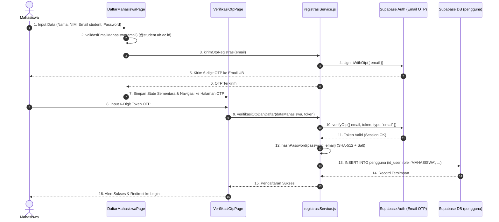
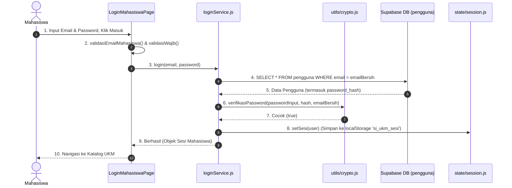
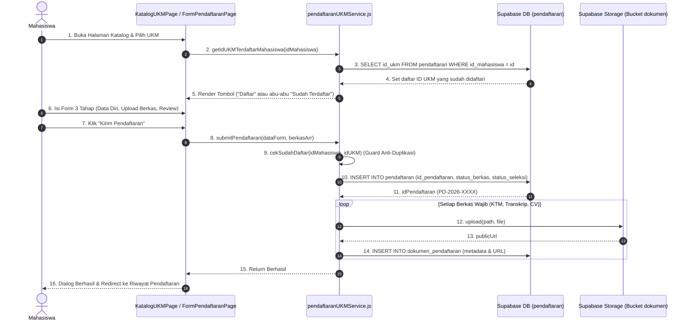
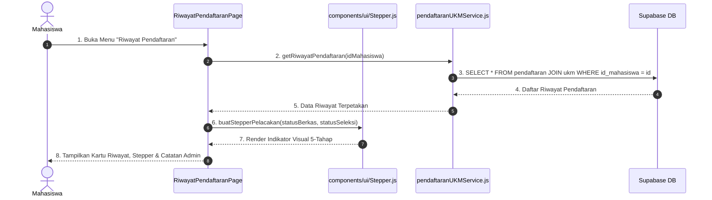
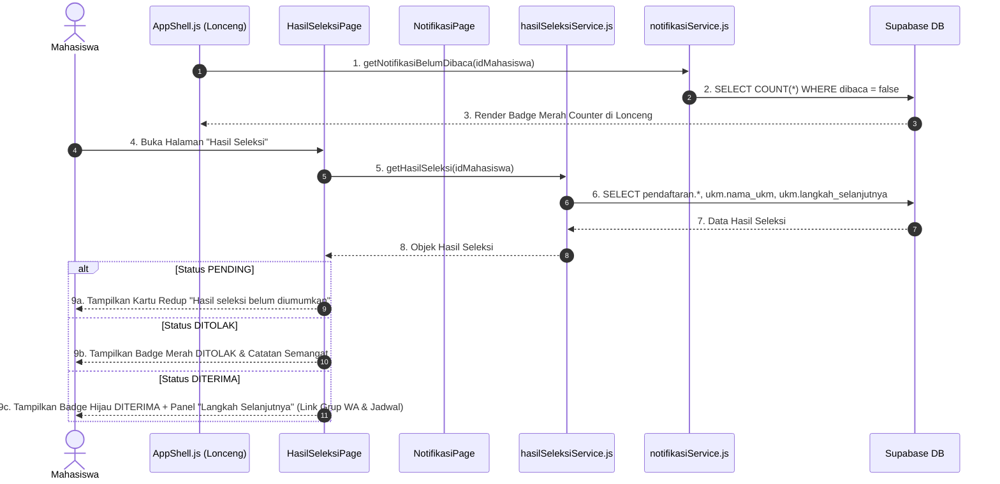

# Bedah Detail: Pemetaan Seluruh Diagram EA Sisi Mahasiswa vs Implementasi Kode Riil
**Proyek: Sistem Informasi Pendaftaran UKM Universitas Brawijaya (SI UKM UB)**

Dokumen ini membedah secara teknis baris demi baris, fungsi demi fungsi, dan method demi method hubungan antara **seluruh Sequence Diagram sisi mahasiswa** dan **Class Diagram** di Enterprise Architect (EA) dengan **Kode Program JavaScript & Database Supabase**.

---

## 1. Bedah SD-1: Registrasi Akun Mahasiswa Baru & Verifikasi OTP
*File EA: `Registrasi Akun Mahasiswa Baru & Verifikasi Akun OTP.qea`*

### Rincian Fungsi yang Terlibat:
1. **`validasiEmailMahasiswa(email)`** di `src/utils/validatorAuth.js`:
   * Memastikan domain email berakhiran `@student.ub.ac.id`.
2. **`kirimOtpRegistrasi(email)`** di `src/services/registrasiService.js`:
   * Mengirimkan OTP 6-digit asli via SMTP Supabase Auth.
3. **`hashPassword(password, email)`** di `src/utils/crypto.js`:
   * Mengamankan kata sandi menggunakan Web Crypto API: `crypto.subtle.digest('SHA-512', salt + password)`.
4. **`simpanDataRegistrasiSementara()`** di `src/state/registrasiTemp.js`:
   * Menampung data form langkah 1 di memori sementara sebelum diverifikasi OTP.

---

## 2. Bedah SD-2: Masuk Ke Sistem (Login Mahasiswa)
*File EA: `Masuk Ke Sistem.qea`*

### Rincian Fungsi yang Terlibat:
1. **`login(email, pass)`** di `src/services/loginService.js`:
   * Mengambil data akun berdasarkan email, memverifikasi hash kata sandi, dan memetakan baris dengan `petakanPengguna()`.
2. **`setSesi(pengguna)`** di `src/state/session.js`:
   * Menyimpan sesi login ke `localStorage` agar sesi tidak hilang saat halaman di-refresh.

---

## 3. Bedah SD-3: Pendaftaran UKM Online (Wizard 3 Tahap)
*File EA: `Daftar UKM Secara Online.qea`*

### Rincian Fungsi yang Terlibat:
1. **`getIdUKMTerdaftarMahasiswa(idMahasiswa)`** di `src/services/pendaftaranUKMService.js`:
   * Mengambil seluruh ID UKM yang telah didaftari mahasiswa untuk menonaktifkan tombol di katalog.
2. **`bolehAksesForm(ukm, sudahTerdaftar)`** di `src/utils/permissions.js`:
   * Menolak akses form jika mahasiswa sudah terdaftar atau masa pendaftaran telah berakhir.
3. **`submitPendaftaran(dataForm, berkas)`** di `src/services/pendaftaranUKMService.js`:
   * Menyimpan pendaftaran secara atomik ke database dan mengunggah fisik file ke cloud storage.

---

## 4. Bedah SD-4: Pemantauan Riwayat & Verifikasi Berkas (Stepper 5-Tahap)
*File EA: `Memantau Status Pendaftaran Mahasiswa Setiap UKM.qea`*

### Rincian Fungsi yang Terlibat:
1. **`getRiwayatPendaftaran(idMahasiswa)`** di `src/services/pendaftaranUKMService.js`:
   * Mengambil seluruh pendaftaran mahasiswa beserta detail UKM terkait.
2. **`Stepper 5-Tahap`** di `src/components/ui/Stepper.js`:
   * Mengkalkulasikan status aktif (*1. Terdaftar $\rightarrow$ 2. Verifikasi Berkas $\rightarrow$ 3. Seleksi $\rightarrow$ 4. Pengumuman $\rightarrow$ 5. Selesai*).
3. **Umpan Balik Berkas:**
   * Jika admin memberi status `TIDAK_LENGKAP`, sistem menampilkan kotak catatan evaluasi admin (`catatan_admin`) agar mahasiswa mengetahui perbaikan yang diperlukan.

---

## 5. Bedah SD-5: Pengumuman Hasil Seleksi & Langkah Selanjutnya
*File EA: `Mengumumkan Hasil Seleksi Secara broadcast.qea`*

### Rincian Fungsi yang Terlibat:
1. **`getHasilSeleksi(idMahasiswa)`** di `src/services/hasilSeleksiService.js`:
   * Mengambil data keputusan seleksi dan konfigurasi `langkah_selanjutnya` milik UKM.
2. **`getDaftarNotifikasi(idMahasiswa)` & `tandaiDibaca()`** di `src/services/notifikasiService.js`:
   * Mengelola daftar pesan broadcast resmi dan memperbarui status baca saat diklik.

---

## 6. Bedah Mendalam Class Diagram (Struktur, Relasi, Method & Database)
*File EA: `Class Diagram 2.qea`*

Class Diagram memodelkan struktur berorientasi objek yang direfleksikan 1:1 ke kode program dan tabel database Supabase:

### A. Hirarki Pewarisan (Inheritance / Generalization)
* **Superclass:** `Pengguna` ([`src/models/Pengguna.js`](../src/models/Pengguna.js))
  * Menyimpan identitas autentikasi global: `idUser`, `email`, `role`, `passwordHash`, `statusAkun`.
* **Subclass 1:** `Mahasiswa` ([`src/models/Mahasiswa.js`](../src/models/Mahasiswa.js))
  * Mewarisi `Pengguna` dan menambahkan atribut akademik: `nim`, `namaLengkap`, `fakultas`, `programStudi`, `nomorTelepon`.
* **Subclass 2:** `AdminUKM` ([`src/models/AdminUKM.js`](../src/models/AdminUKM.js))
  * Mewarisi `Pengguna` dan menambahkan keterikatan ke UKM: `idUKM`, `namaLengkap`, `hakAkses`.
* **Subclass 3:** `SuperAdmin` ([`src/models/Pengguna.js`](../src/models/Pengguna.js))
  * Mewarisi `Pengguna` dengan wewenang verifikasi UKM baru dan statistik global.

### B. Relasi Komposisi & Asosiasi Antar Kelas
1. **Komposisi Berkas (`Pendaftaran` $\rightarrow$ `DokumenPendaftaran`):**
   * Relasi *1 to Many Composition*. Sebuah berkas dokumen tidak memiliki arti tanpa adanya entitas pendaftaran induk.
   * Di database: `dokumen_pendaftaran.id_pendaftaran` mengacu ke `pendaftaran.id_pendaftaran` dengan `ON DELETE CASCADE`.
2. **Asosiasi Pendaftaran (`Mahasiswa` $\rightarrow$ `Pendaftaran` $\leftarrow$ `UKM`):**
   * Relasi *Many-to-Many* yang dijembatani oleh entitas `Pendaftaran`.
   * Di database: Dijamin oleh `UNIQUE INDEX (id_ukm, id_mahasiswa)` untuk mencegah pendaftaran ganda pada UKM yang sama.
3. **Asosiasi Notifikasi (`Mahasiswa` $\rightarrow$ `Notifikasi`):**
   * Relasi *1 to Many*. Mahasiswa menerima banyak notifikasi terkait progres seleksi pendaftaran UKM miliknya.

### C. Implementasi Method Kelas pada Kode
* **`UKM` ([`src/models/UKM.js`](../src/models/UKM.js)):**
  * `findByStatus(daftarUKM, status)` $\rightarrow$ Filter UKM pendaftaran dibuka/ditutup.
  * `findById(daftarUKM, idUKM)` $\rightarrow$ Pencarian detail UKM.
  * `countByKategori(daftarUKM, idKategori)` $\rightarrow$ Agregasi jumlah UKM per kategori.
* **`Pendaftaran` ([`src/models/Pendaftaran.js`](../src/models/Pendaftaran.js)):**
  * `kunciPendaftaran()` $\rightarrow$ Mengunci form agar tidak bisa diubah pasca-submit.
  * `updateStatusBerkas(status, catatan)` $\rightarrow$ Memperbarui progres verifikasi berkas.
  * `updateStatusSeleksi(status, catatan)` $\rightarrow$ Memperbarui kelulusan pendaftar.
* **`Notifikasi` ([`src/models/Notifikasi.js`](../src/models/Notifikasi.js)):**
  * `tandaiDibaca()` $\rightarrow$ Mengubah flag `dibaca = true`.
