# Panduan Arsitektur & Penjelasan Kode SI UKM UB
**Dokumentasi Teknis Sistem Informasi Pendaftaran UKM UB**

Dokumen ini menjelaskan struktur arsitektur sistem informasi, penerapan prinsip rekayasa perangkat lunak modern (**Single Responsibility Principle / SRP**, **Separation of Concerns**, dan **Boundary-Control-Entity / BCE**), serta bagian kode krusial di setiap file.

---

## 1. Arsitektur Tingkat Tinggi: MVC (Model-View-Controller) & Pola BCE

Aplikasi ini dibangun menggunakan arsitektur modular murni (**Vanilla JavaScript ES Modules + Vite**) yang menerapkan pola **MVC (Model-View-Controller)** modern, selaras dengan pola **BCE (Boundary-Control-Entity)** pada analisis Enterprise Architect (EA):

```mermaid
flowchart LR
    subgraph VIEW ["1. VIEW (Boundary di EA)"]
        V1["src/pages/<br/>(Katalog, Detail, Form, Riwayat)"]
        V2["src/components/<br/>(UKMCard, Stepper, Dialog)"]
    end

    subgraph CONTROLLER ["2. CONTROLLER (Control di EA)"]
        C1["src/router.js<br/>(Client-Side Route Controller)"]
        C2["src/services/<br/>(Business Logic & API Orchestration)"]
    end

    subgraph MODEL ["3. MODEL (Entity di EA)"]
        M1["src/models/<br/>(Mahasiswa, UKM, Pendaftaran)"]
        M2["src/enums/<br/>(Status Pendaftaran, Berkas, Seleksi)"]
        M3["Supabase Database<br/>(PostgreSQL Relational Tables)"]
    end

    VIEW <-->|Interaksi Pengguna & Event| CONTROLLER
    CONTROLLER <-->|Query Data & Mutasi State| MODEL
```

### Tabel Komparasi MVC vs BCE dalam Proyek:
* **View (Boundary)**: Bertanggung jawab murni pada tampilan antarmuka (UI/HTML/CSS), menerima input user, dan menampilkan data. **View dilarang query database langsung.**
* **Controller (Control)**: Otak logika bisnis dan pengendali alur. Menerima aksi dari View, melakukan validasi bisnis, memproses transaksi pendaftaran, berkoordinasi dengan database/Cloud Storage, lalu mengembalikan status ke View.
* **Model (Entity)**: Struktur entitas data, relasi antar tabel, dan aturan domain objek.

---

## 2. Struktur Folder `src/` & Klasifikasi MVC Beserta Alasannya

Berikut klasifikasi peran setiap folder di dalam `src/` berdasarkan arsitektur **MVC**, lengkap dengan alasan arsitekturalnya:

| Folder / File | Klasifikasi MVC | Tanggung Jawab Utama | Alasan Kenapa Masuk Kategori Ini |
| :--- | :--- | :--- | :--- |
| `src/pages/` | **VIEW** | Halaman antarmuka spesifik (dibagi `auth/` dan `mahasiswa/`). | **Alasan:** Folder ini berisi kode yang langsung merender elemen DOM (HTML), menangani event visual (klik tombol, input form), dan berinteraksi langsung dengan mata pengguna. Halaman sama sekali tidak boleh tahu query SQL atau tabel database secara langsung. |
| `src/components/` | **VIEW** | Komponen UI visual modular (Card, Stepper, Dialog, Input Form). | **Alasan:** Merupakan blok visual independen tanpa logika bisnis. Tugasnya murni menerima parameter (*props*) dan menampilkan komponen UI yang konsisten dan dapat digunakan berulang kali. |
| `src/layouts/` | **VIEW** | Rangka layout umum web (`AppShell.js`), header, navbar, footer. | **Alasan:** Mengatur struktur visual global pembungkus halaman (frame) dan penempatan navigasi yang dilihat pengguna di seluruh layar. |
| `src/styles/` | **VIEW (Styling)** | CSS global, CSS variables warna tema UB, tipografi, grid layout. | **Alasan:** Mengontrol aspek presentasi murni (warna, jarak, responsivitas layar) yang melengkapi tampilan View. |
| `src/services/` | **CONTROLLER** | Layer logika bisnis, pemrosesan pendaftaran, validasi data, orkestrasi API Supabase. | **Alasan:** Menjadi 'otak' perantara. Ketika View meminta data atau mengirim form, Service yang memproses logika bisnisnya, memvalidasi aturan sistem, mengeksekusi transaksi database, dan mengembalikan hasil olahan ke View. |
| `src/router.js` | **CONTROLLER (Navigation)** | Client-Side Router berbasis URL hash (`#/mahasiswa/...`). | **Alasan:** Berperan sebagai *Front Controller* yang mengatur alur perpindahan layar aplikasi. Router mencegat perubahan URL, mengecek hak akses sesi (*route guard*), dan menentukan View mana yang harus dirender. |
| `src/utils/` | **CONTROLLER (Logic Helper)** | Validasi berkas, validasi email UB, enkripsi hash SHA-512, guard hak akses. | **Alasan:** Berisi modul logika pemrosesan dan validasi data independen. Modul ini digunakan oleh Controller/Service untuk memvalidasi input sebelum diteruskan ke Model/Database. |
| `src/models/` | **MODEL** | Representasi entitas domain sistem (`Mahasiswa`, `UKM`, `Pendaftaran`, dll). | **Alasan:** Berisi definisi struktur data dan objek domain nyata dari sistem. Folder ini mendefinisikan atribut apa saja yang dimiliki oleh suatu entitas data (mencerminkan Class Diagram di modul). |
| `src/enums/` | **MODEL (Data Schema)** | Konstanta resmi status data (`statusPendaftaran`, `statusBerkas`, `roles`). | **Alasan:** Menjadi acuan nilai sah (*domain constraint / allowable values*) dari atribut yang ada pada Model, menjaga konsistensi integritas data sistem (*Single Source of Truth*). |
| `src/state/` | **MODEL (Client-side State)** | Pengelola state lokal di browser (sesi aktif pengguna via `localStorage`). | **Alasan:** Berfungsi sebagai *In-Memory Data Store* di sisi browser yang menyimpan status data pengguna yang sedang aktif (siapa yang login, role-nya apa, data pendaftaran sementara). |
| `src/config.js` & `main.js` | **CORE / CONTROLLER** | Inisialisasi awal aplikasi dan penyedia konfigurasi API. | **Alasan:** Mengorkestrasikan bootstrap pertama kali saat aplikasi dibuka di browser, memuat dependensi inti, dan menyalakan controller router. |

---

## 3. Fungsi Folder & File di Luar `src/` (Root Project `app/`)

Folder dan file di luar `src/` bertugas mengelola **lingkungan pengembangan (development environment)**, **pengujian otomatis**, **database/backend**, dan **deployment**:

### A. Folder di Luar `src/`
| Folder | Fungsi & Tanggung Jawab |
| :--- | :--- |
| **`supabase/`** | Berisi berkas skrip SQL database PostgreSQL Supabase: skema tabel (`schema.sql`), data awal dummy (`seed.sql`), kebijakan keamanan baris (**Row Level Security / RLS** di `rls-tulis.sql`), dan skrip simulasi pengumuman (`pengumuman-dummy.sql`). |
| **`tests/`** | Kumpulan berkas pengujian otomatis (**Automated Unit Tests**) menggunakan framework **Vitest** (menguji validasi form, hak akses pendaftaran, dan fungsi utilitas). |
| **`public/`** | Menyimpan aset statis yang tidak perlu diproses oleh bundler Vite (seperti logo instansi, ikon SVG sprite, gambar banner, favicon). |
| **`dist/`** | Hasil kompilasi/bundle akhir aplikasi web (`npm run build`) berupa HTML, CSS, dan JS yang sudah dioptimasi dan minifikasi untuk siap diunggah ke server hosting (Vercel/Production). |
| **`node_modules/`** | Direktori tempat package pihak ketiga terinstall via NPM (seperti Vite, Vitest, Supabase JS SDK). |
| **`coverage/`** | Laporan hasil persentase cakupan pengujian unit test (*code coverage report*) yang dibuat otomatis oleh Vitest. |
| **`testing/`** | Berkas referensi pengujian tambahan dan panduan skenario QA internal. |

### B. Berkas Konfigurasi di Luar `src/`
| Berkas | Fungsi & Tanggung Jawab |
| :--- | :--- |
| **`package.json`** | Manifest proyek Node.js: mendefinisikan dependensi library, script perintah (`dev`, `build`, `test`), dan versi proyek. |
| **`vite.config.js`** | Berkas konfigurasi bundler **Vite** dan runner pengujian **Vitest**. |
| **`vercel.json`** | Konfigurasi serverless hosting **Vercel** untuk menangani Single Page Application (SPA rewrite routing). |
| **`index.html`** | Berkas HTML utama yang menjadi pintu masuk Single Page Application (tempat elemen `#app` dimuat). |
| **`.env`** & **`.env.example`** | Berkas penyimpan variabel rahasia lingkungan (Environment Variables) seperti URL API dan API Key Supabase. |
| **`.gitignore`** | Daftar file atau folder yang tidak boleh diunggah ke Git repository (misal `node_modules/`, `.env`, `dist/`). |

---

## 3. Rincian Setiap File & Bagian Kode Krusial

### A. Root (`src/`)
* [config.js](file:///d:/Tugas%20Kuliah/Semester%203/Praktikum%20RSI/SI%20UKM%20UB/app/src/config.js): Menyimpan kredensial Supabase (`supabaseUrl`, `supabaseAnonKey`) dan storage bucket.
* [main.js](file:///d:/Tugas%20Kuliah/Semester%203/Praktikum%20RSI/SI%20UKM%20UB/app/src/main.js): Titik awal eksekusi web, mendaftarkan SVG icons sprite ke DOM, dan menginisialisasi router.
* [router.js](file:///d:/Tugas%20Kuliah/Semester%203/Praktikum%20RSI/SI%20UKM%20UB/app/src/router.js): Client-Side Router berbasis URL Hash (`#/mahasiswa/...`).
  * **Poin Penting**: Memiliki route guard yang mengecek session sebelum mengizinkan halaman dibuka.

---

### B. Pages Auth (`src/pages/auth/`)
* [PilihPeranPage.js](file:///d:/Tugas%20Kuliah/Semester%203/Praktikum%20RSI/SI%20UKM%20UB/app/src/pages/auth/PilihPeranPage.js): Pilihan gerbang masuk (Mahasiswa, Pengurus UKM, SuperAdmin).
* [LoginMahasiswaPage.js](file:///d:/Tugas%20Kuliah/Semester%203/Praktikum%20RSI/SI%20UKM%20UB/app/src/pages/auth/LoginMahasiswaPage.js): Form login mahasiswa UB.
  * **Poin Penting**: Memvalidasi akhiran `@student.ub.ac.id`, memanggil `login()`, lalu menyimpan data sesi ke state.
* [DaftarMahasiswaPage.js](file:///d:/Tugas%20Kuliah/Semester%203/Praktikum%20RSI/SI%20UKM%20UB/app/src/pages/auth/DaftarMahasiswaPage.js): Form registrasi data mahasiswa baru (NIM, Nama, Fakultas, Prodi, Password).
  * **Poin Penting**: Mengirim OTP ke email mahasiswa sebelum akun diaktifkan di database.
* [VerifikasiOtpPage.js](file:///d:/Tugas%20Kuliah/Semester%203/Praktikum%20RSI/SI%20UKM%20UB/app/src/pages/auth/VerifikasiOtpPage.js): Form input token 6-digit OTP email UB untuk verifikasi akun nyata.

---

### C. Pages Mahasiswa (`src/pages/mahasiswa/`)
* [KatalogUKMPage.js](file:///d:/Tugas%20Kuliah/Semester%203/Praktikum%20RSI/SI%20UKM%20UB/app/src/pages/mahasiswa/KatalogUKMPage.js): Halaman M-01 katalog pendaftaran.
  * **Poin Penting**: Memanggil `getIdUKMTerdaftarMahasiswa(idUser)` secara paralel untuk menandai UKM yang sudah didaftari sehingga tombol otomatis berubah menjadi "Sudah Terdaftar" (abu-abu/disabled).
* [DetailUKMPage.js](file:///d:/Tugas%20Kuliah/Semester%203/Praktikum%20RSI/SI%20UKM%20UB/app/src/pages/mahasiswa/DetailUKMPage.js): Halaman M-02 informasi UKM, visi misi, timeline, persyaratan berkas, dan hitung mundur sisa waktu pendaftaran.
* [FormPendaftaranPage.js](file:///d:/Tugas%20Kuliah/Semester%203/Praktikum%20RSI/SI%20UKM%20UB/app/src/pages/mahasiswa/FormPendaftaranPage.js): Formulir pendaftaran online multi-tahap (Wizard 3 Langkah):
  * **Langkah 1**: Data diri (auto-fill dari profil sesi) & alasan bergabung.
  * **Langkah 2**: Upload dokumen wajib (KTM, Transkrip, CV) dengan validasi tipe (PDF/JPG) & ukuran (< 5MB).
  * **Langkah 3**: Review ringkasan data, persetujuan fakta integritas, dan konfirmasi submit.
* [RiwayatPendaftaranPage.js](file:///d:/Tugas%20Kuliah/Semester%203/Praktikum%20RSI/SI%20UKM%20UB/app/src/pages/mahasiswa/RiwayatPendaftaranPage.js): Halaman M-08 pelacakan status pendaftaran.
  * **Poin Penting**: Menampilkan **Stepper 5-Tahap** (Terdaftar $\rightarrow$ Verifikasi Berkas $\rightarrow$ Seleksi $\rightarrow$ Pengumuman $\rightarrow$ Selesai) dan catatan perbaikan berkas dari admin.
* [HasilSeleksiPage.js](file:///d:/Tugas%20Kuliah/Semester%203/Praktikum%20RSI/SI%20UKM%20UB/app/src/pages/mahasiswa/HasilSeleksiPage.js): Halaman M-09 hasil seleksi penerimaan.
  * **Poin Penting**: Menampilkan kartu status dinamis (badge hijau DITERIMA, abu PENDING, merah DITOLAK). Jika DITERIMA, otomatis menampilkan instruksi langkah berikutnya (Link Grup WhatsApp, kontak pengurus).
* [NotifikasiPage.js](file:///d:/Tugas%20Kuliah/Semester%203/Praktikum%20RSI/SI%20UKM%20UB/app/src/pages/mahasiswa/NotifikasiPage.js): Daftar pesan masuk/pengumuman broadcast resmi dari UKM ke mahasiswa.
* [ProfilPage.js](file:///d:/Tugas%20Kuliah/Semester%203/Praktikum%20RSI/SI%20UKM%20UB/app/src/pages/mahasiswa/ProfilPage.js): Tampilan data profil akun mahasiswa yang sedang login.

---

### D. Services Layer (`src/services/`)
* [supabaseClient.js](file:///d:/Tugas%20Kuliah/Semester%203/Praktikum%20RSI/SI%20UKM%20UB/app/src/services/supabaseClient.js): Inisialisasi koneksi SDK `@supabase/supabase-js`.
* [loginService.js](file:///d:/Tugas%20Kuliah/Semester%203/Praktikum%20RSI/SI%20UKM%20UB/app/src/services/loginService.js): Query ke tabel `pengguna` dan verifikasi hash kata sandi.
* [registrasiService.js](file:///d:/Tugas%20Kuliah/Semester%203/Praktikum%20RSI/SI%20UKM%20UB/app/src/services/registrasiService.js): Penanganan pengiriman OTP via Supabase Auth dan penyimpanan data akun baru ke database.
* [pendaftaranUKMService.js](file:///d:/Tugas%20Kuliah/Semester%203/Praktikum%20RSI/SI%20UKM%20UB/app/src/services/pendaftaranUKMService.js): **File paling krusial pada sistem**:
  * `getKatalogUKM()`: Mengambil seluruh UKM yang terverifikasi.
  * `getIdUKMTerdaftarMahasiswa(idMahasiswa)`: Mengambil daftar ID UKM yang sudah pernah didaftari mahasiswa untuk validasi UI.
  * `cekSudahDaftar(idMahasiswa, idUKM)`: Guard query ke tabel `pendaftaran`.
  * `submitPendaftaran(dataForm, berkas)`: Menjalankan penyimpanan data ke tabel `pendaftaran`, mengunggah fisik file berkas ke Supabase Cloud Storage, dan mencatat URL-nya ke tabel `dokumen_pendaftaran`.
* [hasilSeleksiService.js](file:///d:/Tugas%20Kuliah/Semester%203/Praktikum%20RSI/SI%20UKM%20UB/app/src/services/hasilSeleksiService.js): Mengambil data pengumuman hasil seleksi dan langkah lanjutan.
* [notifikasiService.js](file:///d:/Tugas%20Kuliah/Semester%203/Praktikum%20RSI/SI%20UKM%20UB/app/src/services/notifikasiService.js): Mengambil data notifikasi mahasiswa dan update status baca (`markAsRead`).
* [pemetaanBaris.js](file:///d:/Tugas%20Kuliah/Semester%203/Praktikum%20RSI/SI%20UKM%20UB/app/src/services/pemetaanBaris.js): Menerapkan pola **Data Mapper** yang mengubah format tabel database (snake_case) menjadi objek model aplikasi (camelCase).

---

### E. State & Utils (`src/state/` & `src/utils/`)
* [session.js](file:///d:/Tugas%20Kuliah/Semester%203/Praktikum%20RSI/SI%20UKM%20UB/app/src/state/session.js): Mengelola sesi pengguna yang sedang aktif, disinkronkan dengan `localStorage` agar tidak hilang saat browser di-refresh.
* [crypto.js](file:///d:/Tugas%20Kuliah/Semester%203/Praktikum%20RSI/SI%20UKM%20UB/app/src/utils/crypto.js): Menghasilkan hash kata sandi menggunakan **SHA-512 + Salt email** menggunakan Web Crypto API bawaan browser (tanpa library berat).
* [permissions.js](file:///d:/Tugas%20Kuliah/Semester%203/Praktikum%20RSI/SI%20UKM%20UB/app/src/utils/permissions.js): Business rule untuk mengecek apakah form pendaftaran boleh diakses (cek periode tanggal aktif + status pendaftaran + pengecekan pendaftaran ganda).
* [validatorBerkas.js](file:///d:/Tugas%20Kuliah/Semester%203/Praktikum%20RSI/SI%20UKM%20UB/app/src/utils/validatorBerkas.js): Memeriksa MIME type berkas (hanya PDF/JPG) dan membatasi ukuran maksimal 5MB.
* [validatorAuth.js](file:///d:/Tugas%20Kuliah/Semester%203/Praktikum%20RSI/SI%20UKM%20UB/app/src/utils/validatorAuth.js): Memastikan email yang didaftarkan wajib memiliki domain resmi `@student.ub.ac.id`.

---

