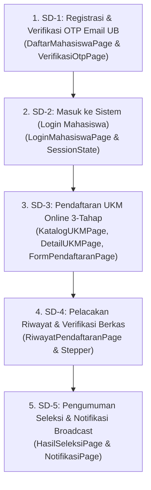
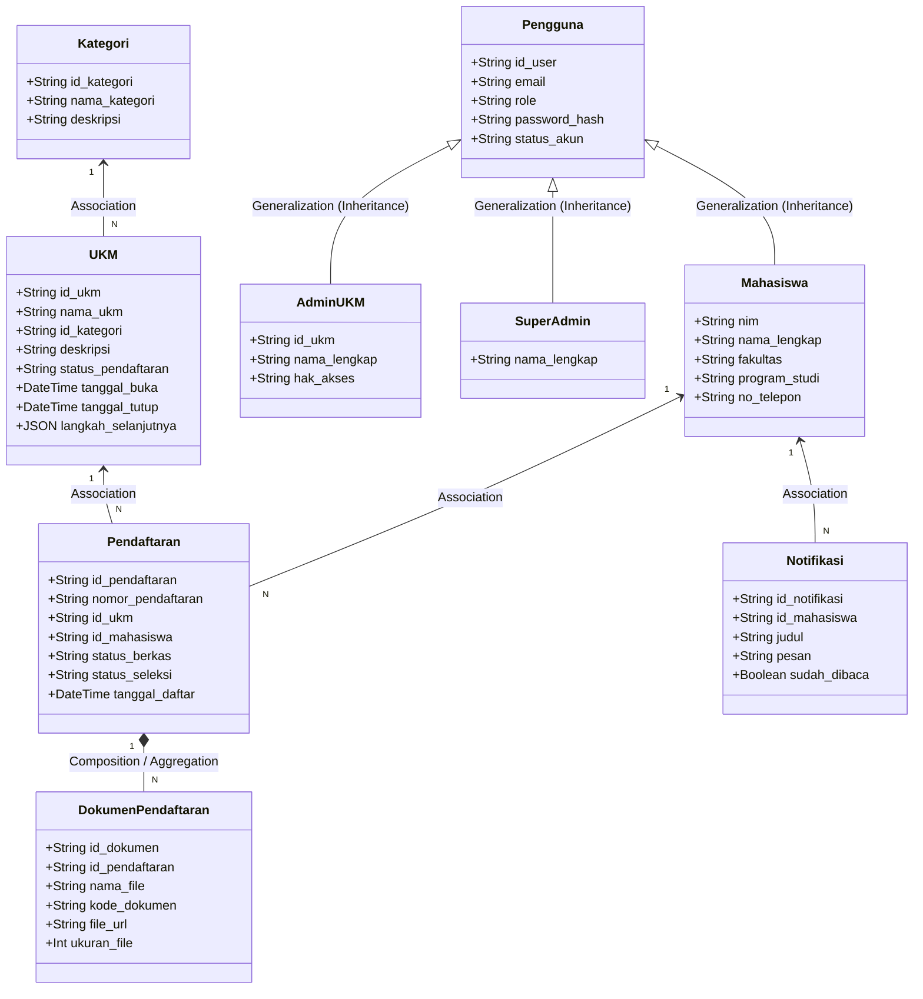

# Matriks Pemetaan Lengkap: Seluruh Diagram EA Sisi Mahasiswa & Backend ke Kode Riil
**Sistem Informasi Pendaftaran UKM Universitas Brawijaya (SI UKM UB)**

Dokumen ini menyajikan pemetaan komprehensif antara **seluruh Diagram di Enterprise Architect (EA)** yang diterapkan pada sistem sisi mahasiswa dan backend ke dalam struktur berkas kode nyata JavaScript, layer Service, dan database Supabase.

---

## 1. Pemetaan 5 Sequence Diagram Utama Sisi Mahasiswa

Sisi mahasiswa mengimplementasikan **5 Sequence Diagram utama** yang mencerminkan seluruh perjalanan pengguna (*User Journey*):

### Tabel Detail 5 Sequence Diagram Sisi Mahasiswa:

| No | Sequence Diagram (EA) | Boundary (View) | Controller / Service | Entity / Model / Database | Alur & Logika Kode Riil |
| :---: | :--- | :--- | :--- | :--- | :--- |
| **SD-1** | **Registrasi Akun Mahasiswa Baru & Verifikasi OTP** | • `DaftarMahasiswaPage.js` • `VerifikasiOtpPage.js` | • `registrasiService.js` • `validatorAuth.js` • `crypto.js` | • `models/Mahasiswa.js` • Tabel `pengguna` • Supabase Auth OTP | Mahasiswa input data diri $\rightarrow$ validasi regex `@student.ub.ac.id` $\rightarrow$ kirim 6-digit OTP via Supabase Auth $\rightarrow$ simpan state sementara di `registrasiTemp.js` $\rightarrow$ verifikasi OTP $\rightarrow$ hashing password SHA-512 + Salt email $\rightarrow$ simpan akun ke tabel `pengguna`. |
| **SD-2** | **Masuk Ke Sistem (Login Mahasiswa)** | • `LoginMahasiswaPage.js` | • `loginService.js` • `router.js` • `crypto.js` | • `models/Pengguna.js` • Tabel `pengguna` • `state/session.js` | Input email student & sandi $\rightarrow$ query akun ke tabel `pengguna` $\rightarrow$ validasi hash SHA-512 $\rightarrow$ simpan objek sesi aktif ke `localStorage` (`setSesi`) $\rightarrow$ redirect ke halaman Katalog UKM. |
| **SD-3** | **Pendaftaran UKM Online (Wizard 3 Tahap)** | • `KatalogUKMPage.js` • `DetailUKMPage.js` • `FormPendaftaranPage.js` • `components/ukm/UKMCard.js` | • `pendaftaranUKMService.js` • `permissions.js` • `validatorBerkas.js` | • `models/Pendaftaran.js` • `models/DokumenPendaftaran.js` • Tabel `pendaftaran`, `dokumen_pendaftaran` • Storage bucket `dokumen` | **Katalog**: cek status pendaftaran per mahasiswa via `getIdUKMTerdaftarMahasiswa()` (jika sudah daftar, tombol abu-abu "Sudah Terdaftar"). **Detail**: hitung sisa waktu mundur & periksa berkas syarat. **Form 3 Tahap**: auto-fill profil sesi (Tahap 1) $\rightarrow$ unggah KTM, Transkrip, CV < 5MB (Tahap 2) $\rightarrow$ review & simpan record pendaftaran serta upload file ke Storage bucket (Tahap 3). |
| **SD-4** | **Pemantauan Riwayat & Verifikasi Berkas (Stepper 5-Tahap)** | • `RiwayatPendaftaranPage.js` • `components/ui/Stepper.js` | • `pendaftaranUKMService.js` • `pemetaanBaris.js` | • `models/Pendaftaran.js` • Kolom `status_berkas`, `catatan_admin`, `tanggal_update_berkas` | Query seluruh riwayat pendaftaran milik user yang login (`getRiwayatPendaftaran()`) $\rightarrow$ render kartu status dengan **Stepper 5-tahap pelacakan** (*Terdaftar $\rightarrow$ Verifikasi Berkas $\rightarrow$ Seleksi $\rightarrow$ Pengumuman $\rightarrow$ Selesai*) $\rightarrow$ menampilkan catatan evaluasi perbaikan berkas dari admin UKM jika status *TIDAK_LENGKAP*. |
| **SD-5** | **Pengumuman Hasil Seleksi & Langkah Selanjutnya** | • `HasilSeleksiPage.js` • `NotifikasiPage.js` • `layouts/AppShell.js` | • `hasilSeleksiService.js` • `notifikasiService.js` | • `models/Notifikasi.js` • Kolom `status_seleksi`, `catatan_seleksi`, `langkah_selanjutnya` | Mengambil data hasil seleksi mahasiswa (`getHasilSeleksi()`) $\rightarrow$ render kartu hasil dengan badge resmi (*DITERIMA* [hijau], *DITOLAK* [merah], *PENDING* [abu-abu]). Jika diterima: tampilkan panel *Langkah Selanjutnya* (link grup WhatsApp UKM & kontak koordinator). Lonceng navbar membaca data unread dari `notifikasi` dan menampilkan angka counter merah. |

---

## 2. Diagram Modul Tambahan Terkait Peran Lain (Admin & SuperAdmin)

Selain 5 diagram sisi mahasiswa di atas, sistem juga mengintegrasikan use case peran pendukung:

| No | Modul Diagram EA | Aktor | Letak Implementasi Kode | Keterangan Integrasi |
| :---: | :--- | :--- | :--- | :--- |
| **6** | **Membuka Periode Pendaftaran UKM** | Admin UKM | • `src/pages/mahasiswa/DetailUKMPage.js` • `src/utils/permissions.js` • `src/utils/format.js` | Mengontrol akses form pendaftaran secara dinamis real-time berdasarkan `tanggal_buka` dan `tanggal_tutup` di database. |
| **7** | **Periksa Kelengkapan Berkas** | Admin UKM | • `src/enums/statusBerkas.js` • Tabel `pendaftaran` | Perubahan status berkas oleh admin langsung terbaca di halaman Riwayat mahasiswa. |
| **8** | **Menentukan Status Penerimaan** | Admin UKM | • `src/enums/statusSeleksi.js` • Tabel `pendaftaran` | Nilai keputusan admin langsung direfleksikan di kartu Hasil Seleksi mahasiswa. |
| **9** | **Meninjau dan Memverifikasi UKM Baru** | SuperAdmin | • `src/services/pendaftaranUKMService.js` | Katalog mahasiswa memfilter secara ketat `status_verifikasi = 'TERVERIFIKASI'`. |
| **10**| **Menjawab Pertanyaan Mahasiswa** | Admin UKM | • `src/pages/mahasiswa/DetailUKMPage.js` • `src/models/Pertanyaan.js` | Difasilitasi lewat saluran komunikasi WhatsApp & Email koordinator resmi UKM. |

---

## 3. Penjelasan Mendalam Terkait Class Diagram

Struktur Class Diagram (`Class Diagram 2.qea`) memodelkan domain sistem informasi secara Object-Oriented dan dipetakan langsung ke kode JavaScript dan database Supabase:

### Prinsip Relasi Class Diagram dan Implementasinya di Kode:

1. **Pewarisan / Generalization (`Pengguna` $\rightarrow$ `Mahasiswa`, `AdminUKM`, `SuperAdmin`):**
   * **Di Diagram EA:** Class `Pengguna` berperan sebagai superclass (class induk) yang menyimpan atribut akun umum (`id_user`, `email`, `role`, `password_hash`), sedangkan `Mahasiswa` menambahkan data akademik (`nim`, `fakultas`, `prodi`).
   * **Di Kode:** File [`src/models/Pengguna.js`](../src/models/Pengguna.js) dan [`src/models/Mahasiswa.js`](../src/models/Mahasiswa.js).
   * **Di Database:** Tabel `pengguna` mengintegrasikan atribut bersama ini dengan pembagian `role = 'MAHASISWA' | 'ADMIN_UKM' | 'SUPERADMIN'`.

2. **Komposisi Berkas (`Pendaftaran` $\rightarrow$ `DokumenPendaftaran`):**
   * **Di Diagram EA:** Relasi Agregasi/Komposisi (*1 Pendaftaran memiliki banyak DokumenPendaftaran*). Dokumen tidak dapat berdiri sendiri tanpa adanya induk pendaftaran.
   * **Di Kode:** File [`src/models/Pendaftaran.js`](../src/models/Pendaftaran.js) dan [`src/models/DokumenPendaftaran.js`](../src/models/DokumenPendaftaran.js).
   * **Di Database:** Tabel `dokumen_pendaftaran` memiliki foreign key `id_pendaftaran` dengan aksi `ON DELETE CASCADE`.

3. **Integritas Relasi UKM & Pendaftaran:**
   * Satu UKM menerima banyak Pendaftaran (`1 to N`).
   * Satu Mahasiswa dapat mendaftar ke beberapa UKM berbeda, namun diproteksi oleh constraint unik: satu mahasiswa hanya boleh mendaftar 1 kali pada UKM yang sama (`UNIQUE INDEX (id_ukm, id_mahasiswa)`).

4. **Penerapan Pola Data Mapper (`src/services/pemetaanBaris.js`):**
   * Karena database Supabase menggunakan standar SQL `snake_case` (contoh: `id_pendaftaran`, `status_berkas`), modul ini menerjemahkannya secara otomatis menjadi atribut objek JavaScript `camelCase` (contoh: `idPendaftaran`, `statusBerkas`) agar sesuai dengan konvensi kode frontend dan diagram OOP.
